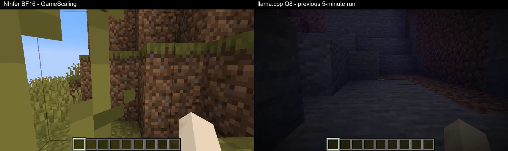

# GameScalingRecurrence

GameScaling-0.8B-S3 在 Windows 上的 **NInfer BF16/CUDA + KVMem + SSE** 与 **llama.cpp Q8/Vulkan** 部署、修复和 Minecraft 实机验证。

**当前结论：两端都能产生并执行动作，但均未完成“走到水边 → 取得原石和原木 → 合成工作台”的完整目标。复现的是部署与验证流程，不保证完成任务，也不保证随机轨迹一致。**

## 两端模型格式不同，不能直接当成引擎排名

同一训练检查点：NInfer 实际为 **BF16 + 少量 FP32**；llama.cpp 实际为 **文本 Q8_0 + FP32、视觉 FP16 + FP32**。Q8_0 以每 32 个权重共 34 字节存储，通常节省权重带宽，但引入量化误差；它不代表激活或 KV Cache 也都是 8 位。

本机模型文件总大小分别为 **1.717 GB / 1.287 GB**，相差约 25.1%，不是一半。审计还发现当前 GGUF 的词嵌入和输出头各存一份相同权重，而 NInfer 共享同一对象。该文件布局差异不代表模型多学了参数。

量化、视觉精度、CUDA/Vulkan、KV 和后续游戏画面均有差异，当前速度差不能只归因于引擎或量化。详见 [BF16 / Q8 的原理、本机张量审计与比较边界](docs/PRECISION.md)。

## 一行安装并验证两个后端

前提：Windows x64、Git、Python 3.12+ x64（实测 3.14.3，加入 PATH）、NVIDIA sm89 显卡和支持 CUDA 13 的驱动。实测显卡为 RTX 4070 Laptop 8 GB；当前预编译 NInfer 不支持宣称任意 GPU 可用。预留至少 15 GB 空间。首次下载约 4.4 GB，不含 Minecraft。

在 **PowerShell** 执行：

```powershell
git clone https://github.com/LANLightning/GameScalingRecurrence.git; if ($?) { powershell -ExecutionPolicy Bypass -File .\GameScalingRecurrence\reproduce.ps1 }
```

此命令建立独立 Python 环境，从固定版本 Release 下载已转换模型与运行库，逐包及逐文件校验 SHA-256，启动两端并各请求 3 次。成功结果保存在 `reports/reproduce-ninfer.json` 和 `reports/reproduce-llama.json`。只复用已有的 GameScaling 端口，不结束已有服务；新建服务在验证后关闭。

不包含 CUDA 编译工具链，也无需现场转换模型。下载资产、参数与哈希见 [release-assets.json](release-assets.json) 和 [runtime-files.json](runtime-files.json)。其他显卡架构需自行重编 NInfer，本仓库附有补丁，但原本机增量链接脚本不是通用构建器。

## 一行启动实机双端录像

先安装并启动 Minecraft Java **1.21.1 / NeoForge 21.1.265**，进入一次新启动 JVM 的单人创造测试世界，站在地上、关闭菜单，不要飞行。需要 JDK 21；附近 96 格内的已保存地形应有暴露水源。游戏和世界路径是新机器的实际路径，不会套用本次试验的玩家坐标。

在仓库目录执行（替换三个路径）：

```powershell
powershell -ExecutionPolicy Bypass -File .\reproduce.ps1 -VerifyOnly -GameDir '<GAME_DIR>' -World '<WORLD_DIR>' -JavaHome '<JDK21_HOME>'
```

脚本自动识别唯一 Minecraft JVM；有多个实例时添加 `-GamePid 12345`。运行后切回 Minecraft 并关闭菜单。它会记录当前起点、建立观察用水源参考，NInfer 和 llama.cpp 各运行 300 秒，生成原速录像、坐标轨迹、决策日志和统计；结束时恢复玩家状态并验证桥接卸载。`-Backend ninfer` 可只测 NInfer。

模型只收到固定目标、截图与历史。桥的实体数据只用于记录和实验间复位；不会给模型路线或中途纠正。模型自己的 Esc 菜单继续由模型处理；失焦或人工打开暂停菜单停止输入。请使用可丢弃的测试世界：复位玩家不等于回滚模型改动的方块和实体。每次完整测试使用新启动的 Minecraft JVM。

水源判定是已保存、半径 96 格范围内最上层暴露水源的三维距离参考，不保证是全世界或步行路径意义上的最近水源。观察到合成格配方和工作台入包才记合成证据，但不是逐物品来源追踪。

## 已完成的实机结果

| 指标 | NInfer 最新五分钟 | llama.cpp 上轮五分钟 |
|---|---:|---:|
| 时长 | 301.09 s | 301.20 s |
| 决策数 | 227 | 242 |
| 空动作 | 4 | 0 |
| 水平累计路径 | 78.12 格 | 172.15 格 |
| 三维累计路径 | 176.39 格 | 310.91 格 |
| 平均截图至响应 | 1075.05 ms | 969.08 ms |
| 平均模型完整响应 | 1023.79 ms | 912.43 ms |
| 平均帧状态至动作完成回执 | 1324.84 ms | 1241.26 ms |
| 打开创造栏 | 是 | 是 |
| 得到目标物品／完成合成 | 否 | 否 |

右侧是之前的 llama.cpp 试验，并非与 NInfer 补测同期重跑。两端量化、后续画面、负载不同；世界没有整体回滚，旧 llama.cpp 的暂停菜单规则也不同。不能据此做纯推理引擎排名，路径更短也不表示任务效率更高。

[观看／下载五分钟对照 MP4](https://github.com/LANLightning/GameScalingRecurrence/releases/download/v2026.10.26/comparison-5min.mp4) · [下载完整录像和逐步证据](https://github.com/LANLightning/GameScalingRecurrence/releases/download/v2026.10.26/verification-evidence.zip) · [全部 Release 文件](https://github.com/LANLightning/GameScalingRecurrence/releases/tag/v2026.10.26) · [NInfer 原始统计](evidence/ninfer-five-minute-20261026-115537/statistics.json) · [llama.cpp 原始统计](evidence/craft-task-fixed-paired-20261026-111531/statistics.json)

视频压缩包中的 `GameScaling-双端各五分钟对照.mp4` 为完整并排对照；两侧原片也保留。录像 10 FPS、原速、无音频。



## 本仓库包含什么

- `tools/`：已修复的采样、协议适配、SSE、KVMem 服务启动和自动验证入口。
- `client/`：上游 GameScaling 截图、动作协议及客户端，保留 Apache-2.0 许可。
- `bridge/`：本次最新五分钟桥、Java 源码、字节码校验回归与录像统计脚本；Minecraft 版本专用。
- `patches/ninfer-small/`：小模型形状、RoPE、GDN/attention 等适配源码和数值测试。
- `evidence/`：最新结果、配置、修复与卸载证据；完整逐帧记录见 Release。
- `docs/history/`：历史分析与失败记录，必须按时间阅读，最新结论以本 README 为准。
- `middleware/`：状态断言/事件记录原型；没有偷偷参与上述纯模型决策试验。

已修复：显式对齐采样参数、透传 seed，解决原先一直空动作的主要配置差异；精确清除旧虚拟键字节码并重算栈帧，解决卸载 VerifyError；恢复鼠标携带物、合成格、飞行状态；有界等待回执；保留中断证据。没有强制前进、拒绝空动作或删掉不成功的录像。

## 源码验收与许可证

```powershell
.\runtime-env\Scripts\python.exe tools\test_sampling_contract.py
.\runtime-env\Scripts\python.exe tools\test_stream_protocol.py
.\runtime-env\Scripts\python.exe bridge\build_bridge.py --java-home '<JDK21_HOME>' --asm '<ASM_JAR>'
```

最后一条会重建桥并运行 `-Xverify:all` 回归，不会连接游戏。上游来源及二进制许可见 [THIRD_PARTY.md](THIRD_PARTY.md)。大文件在 Release，不塞进 Git 历史；测试结果和缺陷不作为上游官方支持承诺。
